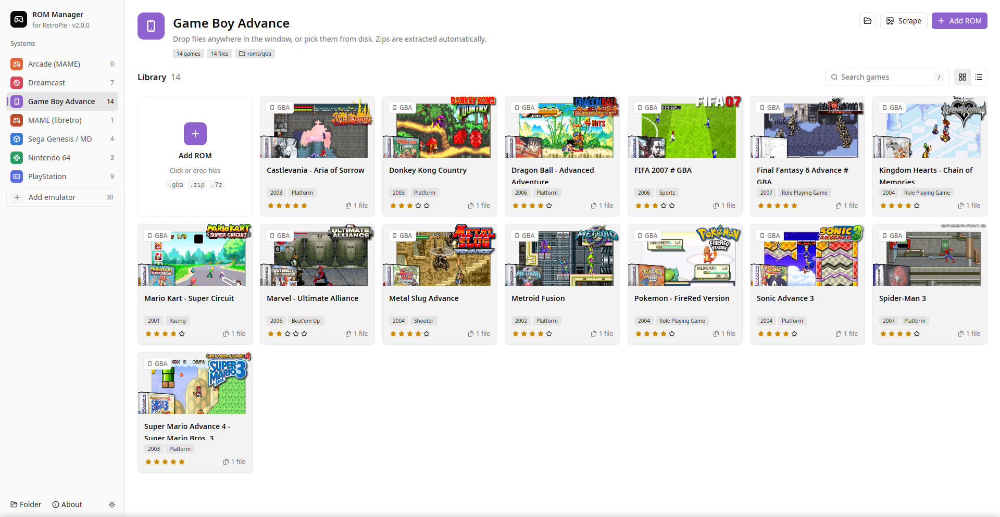
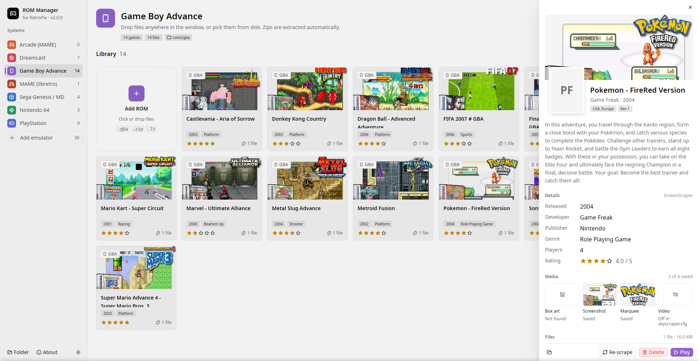
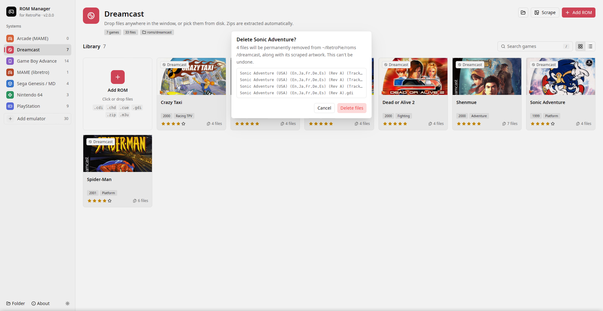
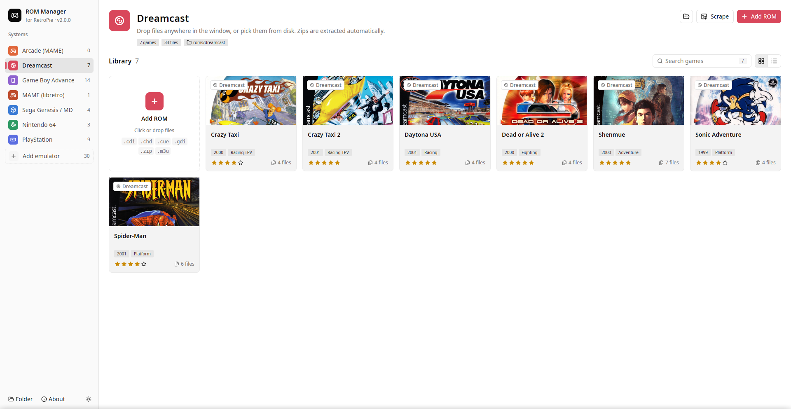

# RetroPie ROM Manager

[](https://github.com/fa-saikat/retropie-rom-installer/releases/latest)
[](LICENSE)


A native desktop app for managing the ROMs on a RetroPie machine. Drop in a download and it lands in the right folder, gets box art from Skyscraper, and shows up in a library you can browse, play from and clean up. You never have to open a file manager or SSH into `~/RetroPie/roms`.



**[Watch the 2-minute demo](https://github.com/user-attachments/assets/617f4d56-7044-47df-a01e-dd780c2e6af7))**: install a zip, scrape it, play it, catch a GBA game dropped on Genesis, switch to dark mode.

## Why

Managing ROMs on RetroPie usually means copying files into the right folder by hand, remembering which extensions each emulator takes, running the scraper from a text menu, and deleting a PlayStation game one `.bin` at a time. This app does all of that from one window, using RetroPie's own folders, emulators and scraper, so nothing it does conflicts with EmulationStation.

## What it does

**Installs from your downloads.** Drag files onto the window or pick them in the file picker. Zips are extracted automatically, except for arcade sets, which MAME needs zipped. Files are copied into `~/RetroPie/roms/<system>`.

**Catches ROMs in the wrong system.** The app reads file headers instead of trusting extensions, because `.zip`, `.bin`, `.cue` and `.chd` are shared by several systems. Drop a Game Boy Advance zip on Genesis and it asks whether to install it to GBA instead. Games already sitting in the wrong folder get a warning and a one-click move. If the right system isn't in your list yet, the app adds it.

**Covers all 37 RetroPie systems.** The sidebar starts with six, and **Add emulator** opens a picker with the rest, grouped by maker. Systems you have games waiting for are listed first, and each card says whether RetroPie has an emulator installed for it.

**Fetches box art and metadata.** After every install the app runs [Skyscraper](https://github.com/Gemba/skyscraper), the scraper RetroPie ships, for just that game. It reads your existing `skyscraper.cfg`, so the result is the same as scraping from the RetroPie menu, and EmulationStation shows the art immediately. If Skyscraper isn't installed, the app offers to install it through RetroPie-Setup. You don't need any API keys.

**Shows one entry per game.** A Dreamcast game made of a `.gdi` and six track files, or a PlayStation game with a `.cue`, its `.bin`s and a save file, appears once in the library. Deleting it removes every one of those files plus the scraped artwork, and the confirmation lists them first.

**Plays games without EmulationStation.** Play starts a game with the emulator RetroPie has set as the default for that system, read from `/opt/retropie/configs/<system>/emulators.cfg`. It uses the same emulator, config files and saves as EmulationStation.

**Has a details panel for every game.** It shows the description, developer, publisher, genre, rating, which media types were saved, and every file on disk with its size. There's also a list view, search (press `/`), and light and dark themes.

<table>
  <tr>
    <td></td>
    <td></td>
  </tr>
  <tr>
    <td align="center">Details, with Play, Re-scrape and Delete</td>
    <td align="center">Delete lists every file before it removes anything</td>
  </tr>
</table>



## Install

Download the `.deb` from the [latest release](https://github.com/fa-saikat/retropie-rom-installer/releases/latest):

```sh
sudo apt install ./retropie-rom-manager_*_amd64.deb
```

Then launch **ROM Manager** from your app menu, or run `retropie-rom-manager`.

The app manages `~/RetroPie/roms`, so it's meant for a desktop Linux machine with [RetroPie installed](https://retropie.org.uk/docs/Debian/). Installing and deleting ROMs works without RetroPie. Play needs RetroPie's emulators, and artwork needs Skyscraper. For stubborn archives, install `unzip` and `p7zip-full` and the app will fall back to them.

## How it works

### Recognising the system

Each check is a fixed signature, not a guess:

- Cartridges: the N64 byte-order marker, the Nintendo logo in Game Boy and GBA headers, iNES and FDS headers, the SNES internal header (checksum pair, map mode, printable title), the `SEGA` header for Genesis and 32X, `TMR SEGA` with its region code to tell Master System from Game Gear, and the Lynx, Atari 7800, Neo Geo Pocket and Vectrex headers.
- Discs: the ISO9660 volume ID for PlayStation (a DVD-sized volume means PS2) and PSP, the Sega IP.BIN header for Dreamcast and Sega CD, GameCube and Wii disc magic (including WBFS, RVZ, WIA and GCZ containers), and GD-ROM metadata inside a CHD.

The app follows `.cue`, `.gdi` and `.m3u` files to their tracks and looks inside single-file zips. A file it can't identify is left alone, so it only warns when it's sure. Results are cached by size and modification time, so a background scan of a large library only reads files that changed.

When a cartridge dump has a generic name, like an N64 game saved as `.bin`, the app installs it with the extension the target emulator expects.

### Grouping multi-file games

Files with an anchor extension (`.m3u`, `.gdi`, `.cue` and similar) name a game. Every other file joins the anchor with the longest matching name that ends at a word boundary, so `Doom (Track 2).bin` joins `Doom.cue`, but `Doomsday.bin` doesn't. Deleting a game removes the exact file list captured when the library was read, so a half-finished copy elsewhere can't take another game's files with it.

### Scraping

The app runs Skyscraper the same way RetroPie-Setup's menu does. First it gathers data and media for the new ROMs into Skyscraper's cache. Then it generates `gamelist.xml` and the images for EmulationStation. Multi-track games are scraped once, through their `.cue`, `.gdi` or `.m3u`.

EmulationStation overwrites `gamelist.xml` when it quits. While it's running, the app only fills the cache and tells you to quit EmulationStation and scrape again.

Installing Skyscraper runs `retropie_packages.sh skyscraper _auto_` from `~/RetroPie-Setup` and streams its output into the window. It only starts when you click it. It uses `sudo` when that works without a password (the RetroPie default) and otherwise `pkexec`. Either way it installs for your user, not root.

## Supported systems

Amstrad CPC, Arcade (MAME), Atari 2600, Atari 5200, Atari 7800, Atari 800, Atari Lynx, ColecoVision, Dreamcast, Fairchild Channel F, Famicom Disk System, FinalBurn Alpha, Game Boy, Game Boy Color, Game Boy Advance, GameCube, MAME (libretro), MSX, Neo Geo, Neo Geo Pocket, Neo Geo Pocket Color, NES, Nintendo 64, PC Engine / TurboGrafx-16, PlayStation, PlayStation 2, PlayStation Portable, Sega 32X, Sega CD, Sega Game Gear, Sega Genesis / Mega Drive, Sega Master System, Sega SG-1000, Super Nintendo, Vectrex, Wii and ZX Spectrum.

Accepted extensions for each one come from RetroPie's `platforms.cfg` and its docs ([`src/systems.rs`](src/systems.rs)).

## Known limitations

- Only an x86_64 `.deb` is published. It should build on a Raspberry Pi from source, but that hasn't been tested yet.
- The ROM folder is fixed at `~/RetroPie/roms`.
- Play always uses the system's default emulator. Per-game choices made in runcommand's menu are ignored, and emulators whose command needs runcommand's video-mode tokens (`%XRES%` and similar) won't start from the app.
- `.7z` archives aren't inspected for the wrong-system check.
- A PlayStation `.chd` can't be told apart from a CD-format Dreamcast one, so those are never flagged.
- Discs of a multi-disc game only group into one entry when an `.m3u` ties them together, which is also how RetroPie treats them.
- Many of the newer systems share generic sidebar icons.

## Building from source

```sh
cargo build --release
./target/release/retropie-rom-manager
```

You'll need a recent stable Rust toolchain and the usual GUI libraries: a working OpenGL or Vulkan driver, `libxkbcommon`, `libasound2`, `libssl` and `fontconfig`. The file picker uses an XDG desktop portal on Wayland and GTK on X11.

The UI is built with [GPUI Kit](https://gpui-kit.com) on top of [GPUI](https://www.gpui.rs), the framework behind the Zed editor. Detection, grouping, scraping and launching have no UI dependency and are covered by `cargo test`.

To build the Debian package, run `./scripts/build-deb.sh` (it needs [`cargo-deb`](https://github.com/kornelski/cargo-deb)). After bumping the version in `Cargo.toml`, `./scripts/generate-changelog.sh` adds the changelog entry.

<details>
<summary>Debug-build environment variables</summary>

Debug builds can open straight into a given state, which helps with screenshots and testing without clicking around. Release builds ignore all of these.

| Variable | Effect |
|---|---|
| `ROM_MANAGER_SYSTEM=<id>` | Open on a system, e.g. `psx` |
| `ROM_MANAGER_VIEW=list` | Start in list view |
| `ROM_MANAGER_THEME=dark` | Start in dark mode |
| `ROM_MANAGER_OPEN=<index>` | Open the details panel for that card |
| `ROM_MANAGER_DIALOG=…` | `delete`, `about`, `install-skyscraper`, `add-system`, `remove-system` or `move` |
| `ROM_MANAGER_RUN=…` | Start `install-skyscraper` or `scrape` right away |
| `ROM_MANAGER_INSTALL=<file>` | Act as if the file was dropped on the window |
| `ROM_MANAGER_CONFIGS=<dir>` | Read emulator configs from a stand-in for `/opt/retropie/configs` |
| `ROM_MANAGER_SETUP_NO_ELEVATE=1` | Run the Skyscraper installer without `sudo` or `pkexec` |

</details>

## Contributing

Bug reports and pull requests are welcome. If a ROM is detected as the wrong system, or isn't detected when it should be, please open an issue with the system, the file name and its size. Don't attach the ROM itself.

## Credits

Developed by Fahim A Saikat and Ukay K Marma. System photos are from Wikimedia Commons, credited in [`assets/systems/CREDITS.md`](assets/systems/CREDITS.md). Icons are from [Tabler](https://tabler.io/icons) and [Lucide](https://lucide.dev). Artwork and metadata come from [Skyscraper](https://github.com/Gemba/skyscraper) and the databases it uses.

This project isn't affiliated with RetroPie. If it saves you some time, a star helps other people find it.

## License

[MIT](LICENSE)
